# Design notes: editorial restyle

A visual-only restyle that replaces the dark "mission control" theme with a light, warm, editorial look (with a system-preference dark mode). No user-visible text, data, feature, route or URL parameter changed; see **Verification**.

The palette and type pairing follow a publicly documented brand guideline (warm neutrals, clay accent, Poppins + Lora). Only colours and typefaces are borrowed. The app uses no logo, wordmark, mark, illustration or name from that brand, and nothing implies endorsement.

## Tokens

All colours are CSS variables in `src/app/globals.css`. Tailwind CSS 4 has no `tailwind.config.ts`; its equivalent is the `@theme` block in `globals.css`, which turns each `--color-*`, `--font-*`, `--radius-*`, `--shadow-*` and `--text-*` variable into utilities (`bg-paper`, `text-clay-strong`, `font-display`, `shadow-card`, …). Plotly cannot read CSS variables, so `src/lib/plotlyTheme.ts` holds the same values for charts.

### Core palette

| Token | Light | Dark | Role |
|---|---|---|---|
| `--ink` | `#141413` | `#faf9f5` | Text, primary button fill, chart axes |
| `--paper` | `#faf9f5` | `#141413` | Page background |
| `--stone` | `#b0aea5` | `#b0aea5` | Dividers, guides, decorative strokes |
| `--sand` | `#e8e6dc` | `#262522` | Subtle panels, chips, footer, hover fills |
| `--clay` | `#d97757` | `#d97757` | Accent fills: active states, accent button, focus ring, flame |
| `--sky` | `#6a9bcc` | `#6a9bcc` | Secondary accent (liquid fuel) |
| `--sage` | `#788c5d` | `#788c5d` | Tertiary accent (gas fuel) |

In dark mode `--ink` and `--paper` swap, so "ink on paper" keeps meaning "text on page" and the primary button inverts automatically.

### Derived tones

| Token | Light | Dark |
|---|---|---|
| `--ink-muted` | `#5e5d59` | `#b0aea5` |
| `--ink-subtle` | `#666660` ¹ | `#989791` |
| `--paper-raised` | `#ffffff` | `#1f1e1c` |
| `--sand-strong` | `#d8d5c8` | `#3a3935` |
| `--clay-strong` | `#9f4e34` ¹ | `#db7e5f` |
| `--clay-soft` | `#f3e3da` | `#3b2a22` |
| `--sky-strong` | `#3b6995` ¹ | `#6a9bcc` |
| `--sky-soft` | `#e1ebf4` | `#1f2a35` |
| `--sage-strong` | `#56683f` | `#899e6c` |
| `--sage-soft` | `#e6eadc` | `#262c1f` |
| `--on-clay` | `#141413` | `#141413` |

¹ **Changed from the brief to pass WCAG AA.** The brief's values failed its own AA requirement:
- `--clay-strong #b85a3c`: 4.37:1 on paper, 3.68:1 on `--clay-soft` (the Extrapolated badge and selected chips).
- `--sky-strong #3f6f9e`: 4.37:1 on `--sky-soft` (the Interpolated badge).
- `--ink-subtle #87867f`: 2.9–3.6:1 on every background.

Each was darkened in the same hue, by the smallest step that gives ≥ 4.6:1 on the hardest background (`--sand`).

The brief only fixed the dark page, raised surface, border, text and secondary text colours. The other dark-mode values were chosen the same way, with lightness adjusted until each pair passes AA. `--on-clay` is a fixed dark text colour for the clay accent button, because light text on clay is 2.96:1.

### Other tokens

- **Radii:** 6px for chips, inputs and controls (`rounded`, `rounded-md`); 12px for cards and panels (`rounded-lg`, `rounded-xl`, `.panel`); 20px for hero blocks and the drawer (`rounded-2xl`, `rounded-3xl`); fully round for pills and buttons.
- **Shadow:** `--shadow-card`, used only on card hover, the "More tools" menu, the Atlas input and the drawer.
- **Type scale:** Tailwind's `text-*` sizes are remapped to the brief's scale. Display is `text-5xl` (3.5rem / 1.05), H1 `text-4xl` (2.5 / 1.1), H2 `text-3xl` (1.875 / 1.2), H3 `text-2xl` (1.375 / 1.3), H4 `text-xl` (1.125 / 1.35), body `text-base` (1.0625 / 1.65), small `text-sm` (0.875 / 1.5), caption `text-xs` (0.8125 / 1.45).
- **Motion:** `--ease-calm: cubic-bezier(.2,.7,.2,1)`. Hover takes 150ms. Below-the-fold sections fade and rise 8px over 250ms when first scrolled into view (`RevealOnScroll`, once each). The flame breathes on a 4s cycle. All motion is off under `prefers-reduced-motion`.

## Typography

All three families are self-hosted through `next/font/google` with `display: "swap"`. Only Poppins is preloaded, because it renders the heading that is the LCP element; preloading all seven files slowed LCP by about 1s on mobile.

| Family | Weights | Use | Licence |
|---|---|---|---|
| Poppins | 400, 500, 600 | Default UI font: headings, nav, buttons, badges, labels, tables, stat numbers, chart text | SIL OFL 1.1 |
| Lora | 400, 500, italic 400 | Paragraphs (`p`, `blockquote`, `dd`), Atlas answers, Learn facts | SIL OFL 1.1 |
| JetBrains Mono | 400, 500 | `.num`: IDs, numbers with units, table numerals, chart ticks (tabular figures) | SIL OFL 1.1 |

## Contrast (WCAG AA)

Generated by `npm run check:contrast` (`scripts/check-contrast.ts`), which reads the hex values straight from `globals.css`.

| Text | Background | Use | Light | Dark |
|---|---|---|---|---|
| `--ink` | `--paper` | body text | 17.50:1 AA | 17.50:1 AA |
| `--ink` | `--paper-raised` | card text | 18.43:1 AA | 15.81:1 AA |
| `--ink` | `--sand` | chips, footer, filter rail | 14.73:1 AA | 14.55:1 AA |
| `--ink-muted` | `--paper` | secondary text | 6.26:1 AA | 8.29:1 AA |
| `--ink-muted` | `--paper-raised` | secondary text on cards | 6.59:1 AA | 7.49:1 AA |
| `--ink-muted` | `--sand` | footer text, analog badge | 5.27:1 AA | 6.89:1 AA |
| `--ink-subtle` | `--paper` | captions | 5.48:1 AA | 6.29:1 AA |
| `--ink-subtle` | `--paper-raised` | captions on cards | 5.78:1 AA | 5.69:1 AA |
| `--clay-strong` | `--paper` | links | 5.52:1 AA | 6.29:1 AA |
| `--clay-strong` | `--paper-raised` | links on cards | 5.81:1 AA | 5.68:1 AA |
| `--clay-strong` | `--clay-soft` | Extrapolated badge, selected chips | 4.65:1 AA | 4.65:1 AA |
| `--clay-strong` | `--sand` | links on sand | 4.64:1 AA | 5.23:1 AA |
| `--sky-strong` | `--sky-soft` | Interpolated badge | 4.78:1 AA | 4.98:1 AA |
| `--sky-strong` | `--paper-raised` | liquid legend text | 5.77:1 AA | 5.69:1 AA |
| `--sage-strong` | `--sage-soft` | Measured badge | 4.98:1 AA | 4.90:1 AA |
| `--sage-strong` | `--paper-raised` | gas legend text, success | 6.09:1 AA | 5.69:1 AA |
| `--ink-subtle` | `--paper` | No data badge (transparent) | 5.48:1 AA | 6.29:1 AA |
| `--paper` | `--ink` | primary button | 17.50:1 AA | 17.50:1 AA |
| `--on-clay` | `--clay` | accent button | 5.90:1 AA | 5.90:1 AA |
| `--paper` | `--clay-strong` | accent button hover | 5.52:1 AA | 6.29:1 AA |
| `--ink` | `--clay-soft` | selected row / correct-wrong quiz text | 14.76:1 AA | 12.94:1 AA |
| `--ink` | `--sage-soft` | quiz correct | 15.07:1 AA | 13.63:1 AA |

Charts are checked separately: axis text uses `--ink-muted`, and hover labels are paper on ink. Lighthouse's own contrast audit passes on every page tested (see below).

## Places where the brief and the existing text disagreed

Rule 1 (no text changes) wins in each case:

- **Colour words in on-screen text.** The Envelope Map coverage chart says "(cyan line)", so the habitat marker there uses `--sky`. Its mobile legend says "green ring = d ≤ 0.35", so that ring uses `--sage-strong`. The Family Tree and investigation pages say "Solid orange edges are curated lineage", so curated edges use `--clay` instead of the brief's `--ink`. The highlighted Saffire → LUCI → FM2 path uses `--clay-strong` at 3px to stay distinct.
- **"Anthropic" / "Claude" in UI files.** The only matches are the existing Space Apps SI disclosure: the `si-disclosure` meta tag in `layout.tsx` and the AI-disclosure list on `/method`. Space Apps requires that disclosure, and rule 1 protects it, so it is unchanged. No new mention was added.
- **Icons.** The UI has no emoji or filled icon set. `✓ ✗ ● ✦ ⚑ →` are text characters and part of the checked text, so they stay. The SVG icons were redrawn as 1.5px outlines (the quality-flag icon lost its fill), and no icon library was added.
- **Stone numerals.** The brief asks for Top Insights rank numbers in `--stone`, but stone is 2.2:1 on paper. They use `--ink-subtle` at 1.875rem instead.
- **Code comments.** The brief says no comments in new code, and none were added. Existing comments in edited files were kept, because they record data caveats the team relies on.

## Charts and graph

- `src/lib/plotlyTheme.ts` holds the palette, `chartTheme(dark)`, `baseLayout()` and `axisStyle()`. `src/lib/useChartTheme.ts` switches between light and dark from `prefers-color-scheme`, and charts redraw when it changes.
- Fuel colours: solid is clay, liquid is sky, gas is sage. Gravity is still shown by marker shape, and basis by filled (stated) versus open 1.5px outline (nominal or approximate).
- Habitat crosshairs are ink, with Poppins 500 labels. The exploration atmosphere (HAB-03) gets a 2px clay ring with a clay-soft halo; this trace has no legend entry and no hover text, so the chart's text is unchanged.
- Iso-ppO₂ guides are dashed stone lines. Coverage hulls use their fuel colour at 8% fill with a 40% outline.
- Hover labels are paper on ink in the mono font. The mode bar appears only on hover, in monochrome.
- Family Tree: nodes are raised cards with a 1px border and a 4px family-colour left edge. A selected node gets a clay border. Edges: curated lineage is clay, derived is dashed stone, related is dotted sky. The background is a sand dot grid, and the tooltip is paper on ink.

## Verification

| Check | Command | Result |
|---|---|---|
| Unit tests (unchanged) | `npm test` | 30 / 30 pass |
| Types and lint | `npm run typecheck && npm run lint` | clean |
| Production build | `npm run build` | 46 / 46 pages |
| No text changes | `npm run check:text -- --before <main url> --after <branch url>` | **No differences** across 42 routes and 12,662 text, `alt`, `aria-label`, `title` and `placeholder` items (both servers run without an AI key, so Ask Atlas shows the same mode) |
| Protected files | `git diff main -- public/data scripts/prepare-data.ts src/app/api src/lib/evidence.ts src/lib/ranking.ts src/lib/__tests__ src/data` | empty |
| Hard-coded colours | `grep -rnE "#[0-9a-fA-F]{3,8}\b\|rgba?\(" src --include='*.ts*' \| grep -v "src/data/\|plotlyTheme.ts"` | nothing |
| Contrast | `npm run check:contrast` | all pairs AA, light and dark |
| Layout | Playwright screenshots of all 12 page types at 375, 768 and 1440px, light and dark (72 images) | no horizontal overflow at any width |

### Lighthouse (production build, local)

| Page | Accessibility | Performance (desktop) | Performance (mobile) | Mobile performance on `main` |
|---|---|---|---|---|
| Home | 100 | 99 | 92–95 | 92 |
| Explorer | 100 | 100 | 65–66 | 67 |
| Matcher | 100 | 99 | 74–79 | 76 |
| Atlas | 100 | 99 | 91–93 | 93 |

Accessibility meets the ≥ 95 target everywhere. Performance meets ≥ 90 on desktop, and on mobile for Home and Atlas. On Lighthouse's throttled mobile profile, Explorer and Matcher score below 90 on `main` as well. That comes from parsing the 2.7 MB burn-card file and from Plotly, not from styling. Fixing it would change how data loads, which is outside a visual-only change.

## Screenshots (1440px)

| Page | Before | After (light) | After (dark) |
|---|---|---|---|
| Home | 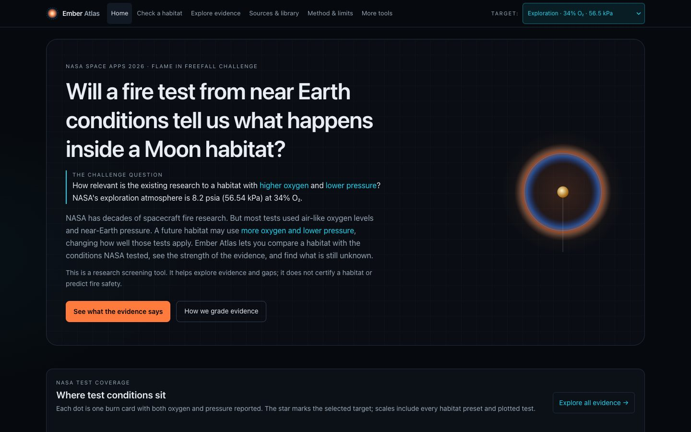 | 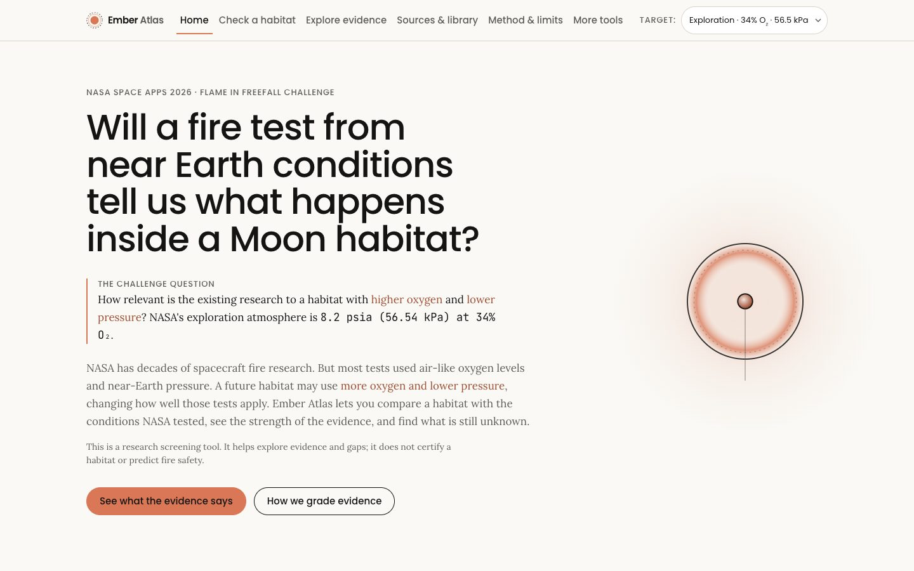 | 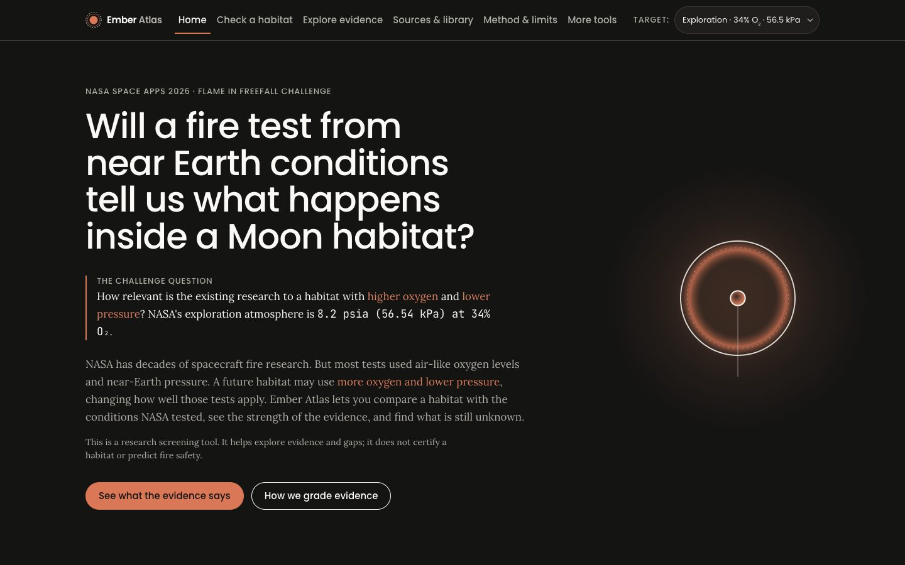 |
| Envelope Map | 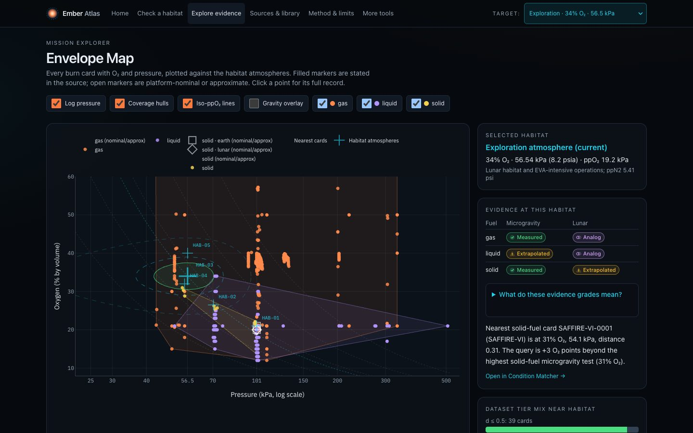 | 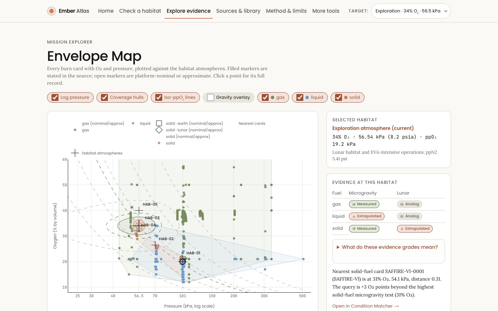 | 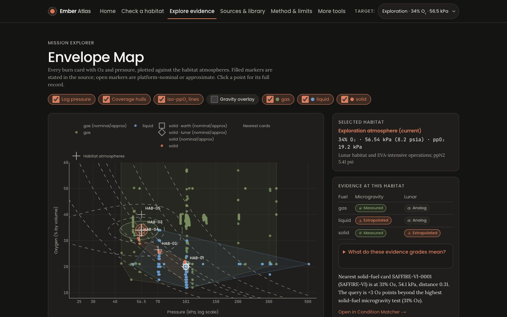 |
| Condition Matcher | 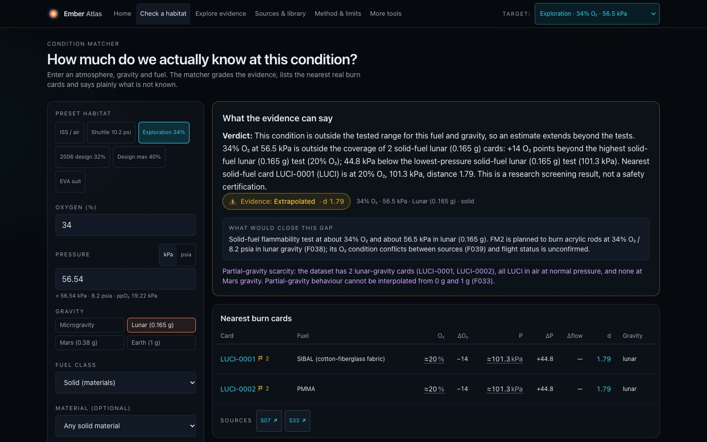 | 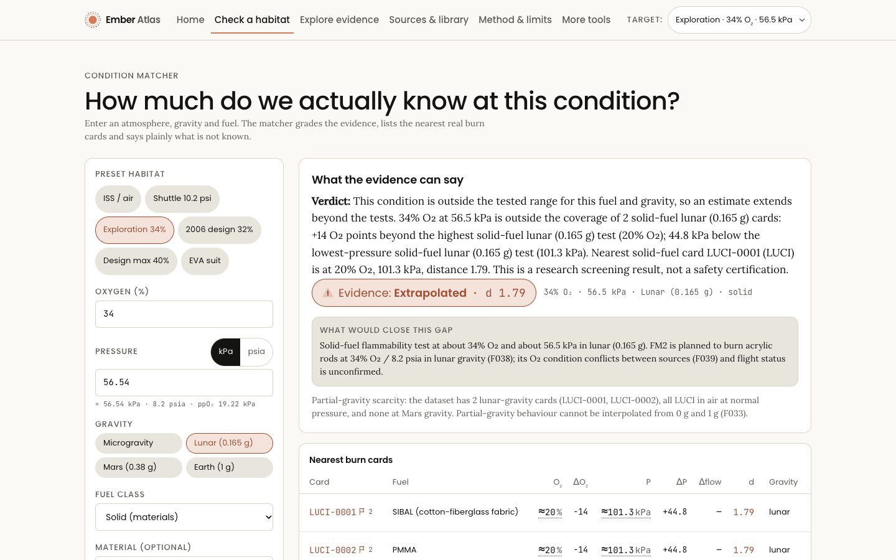 | 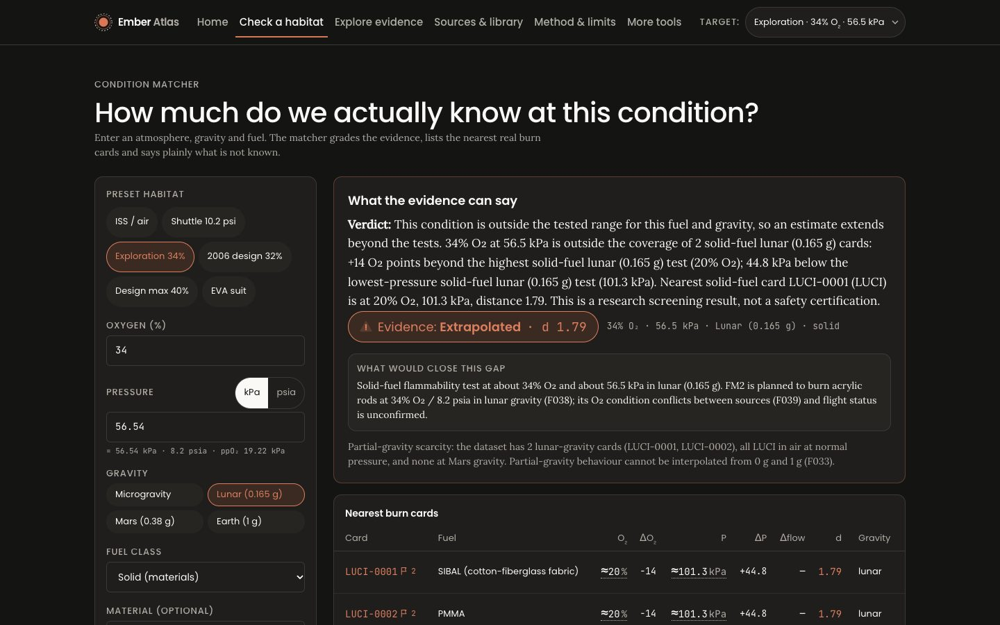 |
| Ask Atlas | 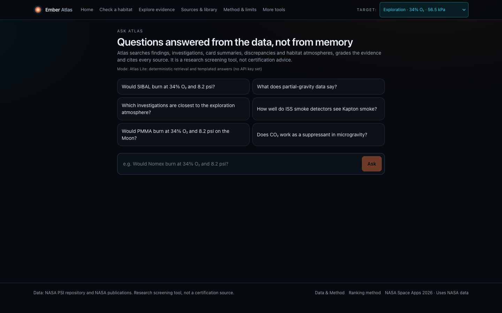 | 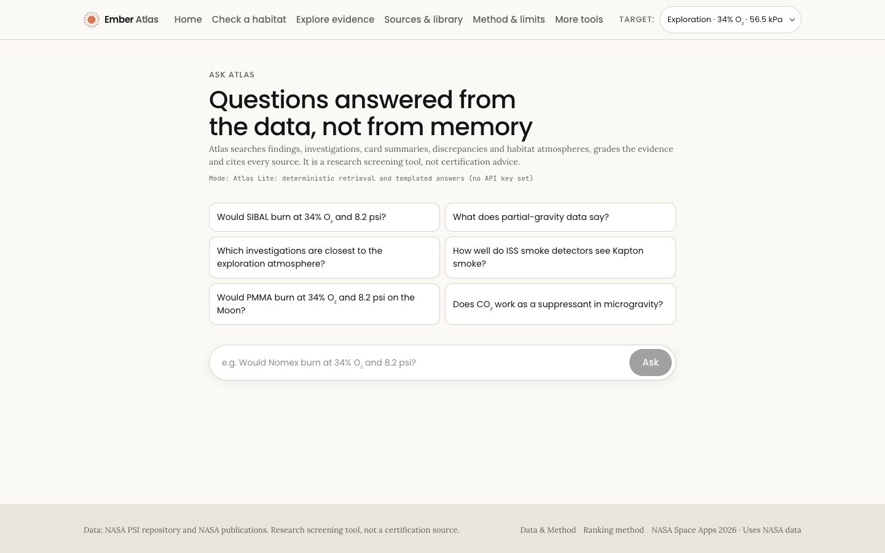 | 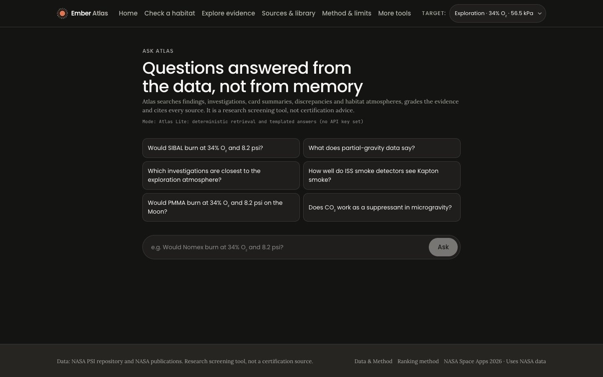 |
| Fire Watch | 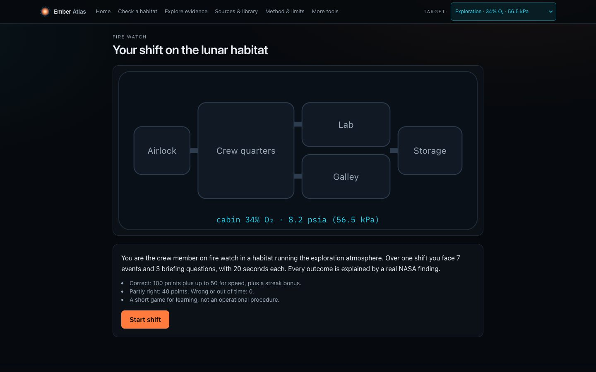 | 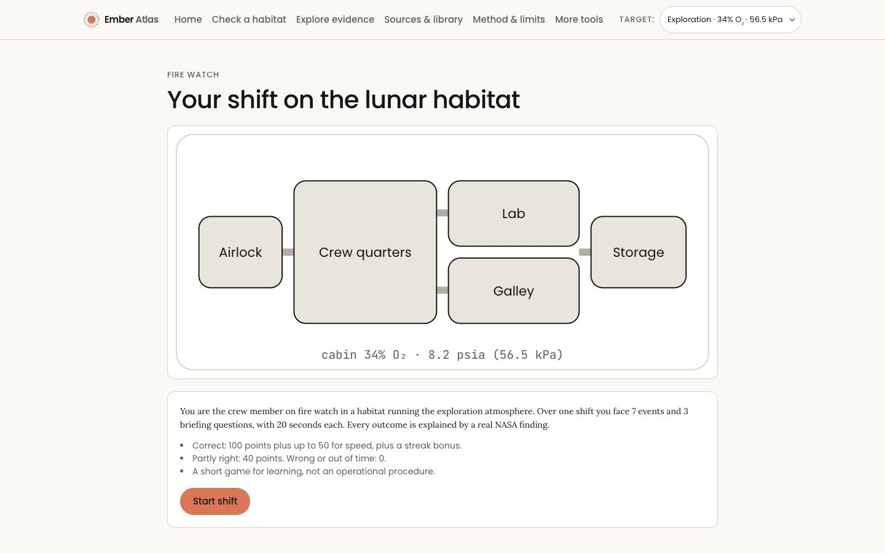 | 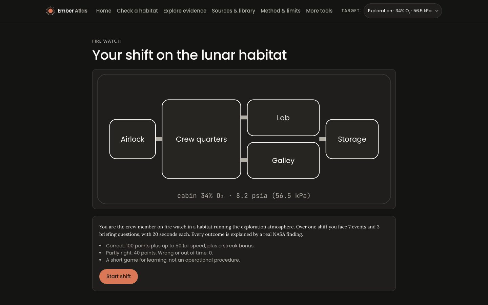 |

## Tooling added

- `playwright` (dev dependency) drives `scripts/check-text-unchanged.ts`. It uses the locally installed Google Chrome (`channel: "chrome"`); set `PLAYWRIGHT_CHANNEL` to use another browser.
- npm scripts: `check:text` and `check:contrast`.
